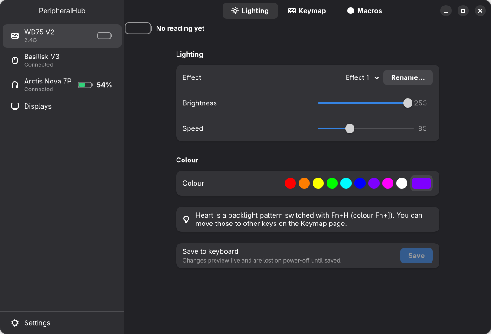
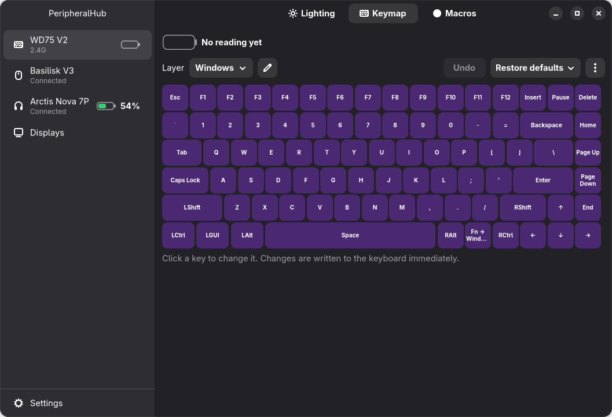
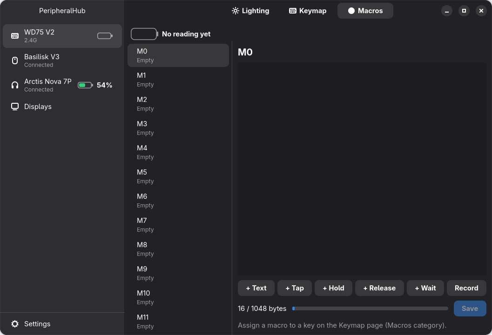
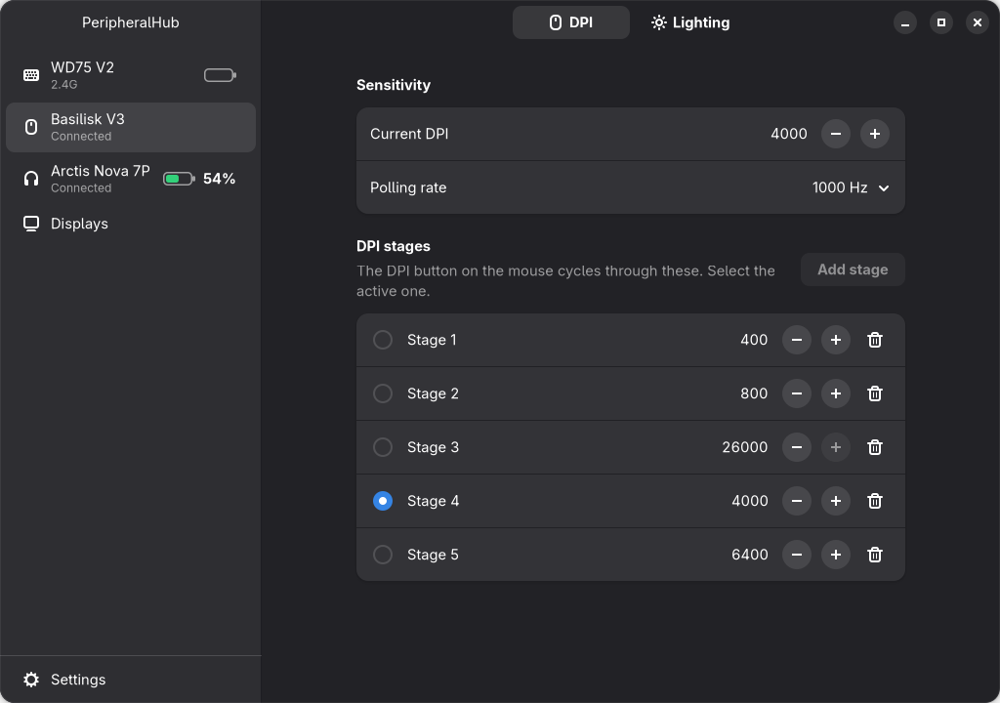
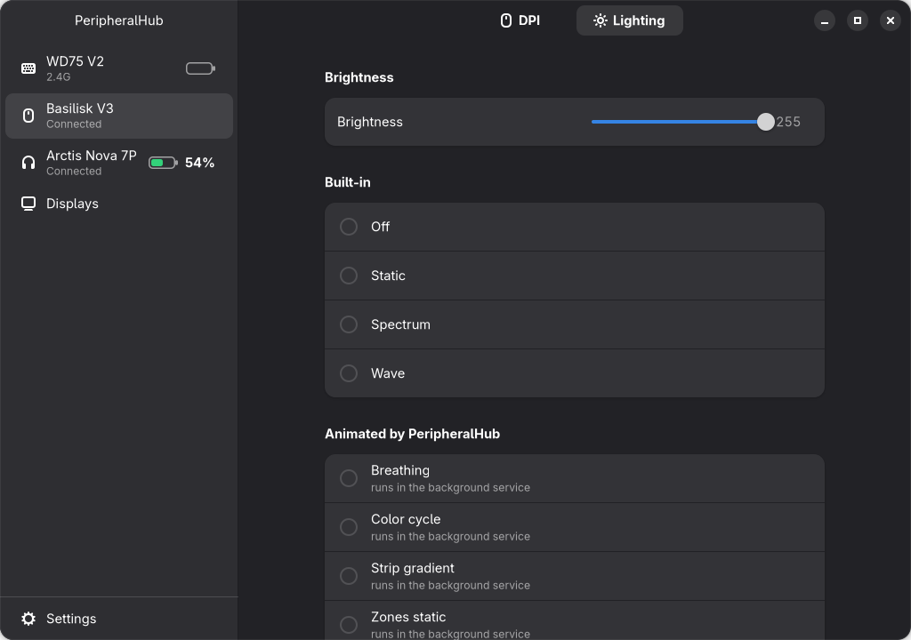
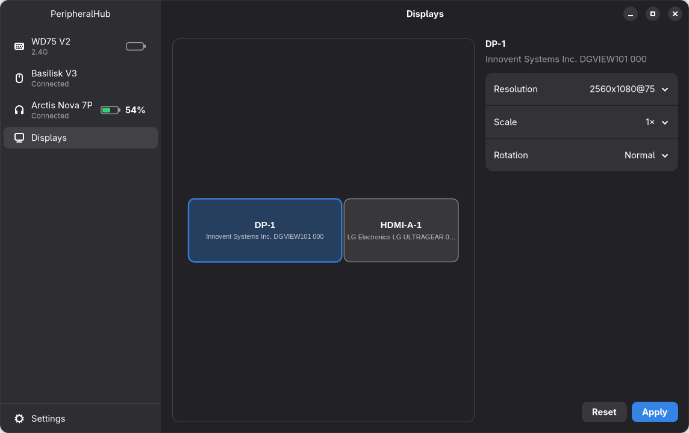
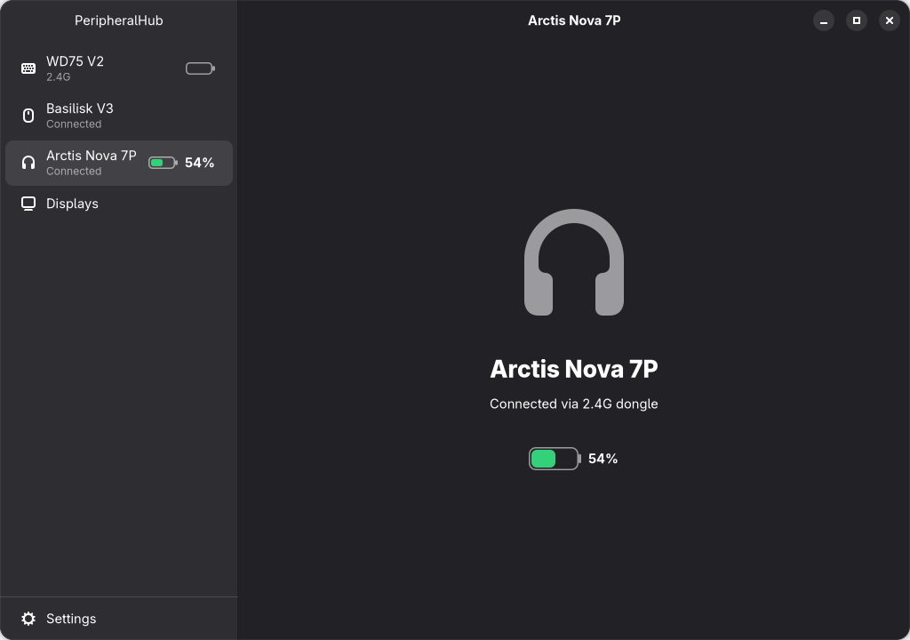

# PeripheralHub for Omarchy

[-ready-2ea44f)](#compatibility)
[](LICENSE)


A native GTK4/libadwaita app for configuring a desk setup on [Omarchy](https://omarchy.org): keyboard lighting, keymaps and macros, mouse DPI and lighting, monitor layout, and battery levels, all in one window. **Omarchy 4 (Quattro) ready.**



The screenshots show the app running against real, connected hardware.

## Features

- **Womier WD75 V2 keyboard:** lighting (effect, colour, speed, brightness), a keymap editor for all 5 layers, and a macro editor with a recorder. Works by cable or the 2.4G dongle, using VIA protocol 12.
- **Razer Basilisk V3 mouse:** DPI, DPI stages, polling rate, brightness and built-in effects, plus animated effects driven by the background service (breathing, colour cycle, strip gradient, per-zone colours, match keyboard).
- **Displays:** drag to arrange monitors, and change resolution, refresh rate, scale and rotation. Every change reverts by itself after 15 seconds unless you press Keep.
- **Batteries:** animated battery levels for the keyboard and the SteelSeries Arctis Nova 7P headset, with a low-battery notification.
- **Background service and CLI:** a small user service and the `phub` command-line tool.
- **Fully customizable:** the code is open and split by device and platform, so you can change it to add your own peripherals or run on other platforms. See [Customizing](#customizing).

## Screenshots

| Keymap editor | Macro editor |
|---|---|
|  |  |

| Mouse DPI | Mouse lighting |
|---|---|
|  |  |

| Displays | Headset |
|---|---|
|  |  |

## Compatibility

Built and tested on **Omarchy 4.0.6 (Quattro)** with Hyprland 0.56.2, GTK 4.24 and libadwaita 1.10. The Displays page reads and edits the Lua `~/.config/hypr/monitors.lua` that Omarchy 4 uses. Other distros and older Omarchy releases are untested.

Supported devices:

| Device | USB ID | Connection |
|---|---|---|
| Womier WD75 V2 | `8888:2222` | Cable or 2.4G dongle for settings; Bluetooth for battery only |
| Razer Basilisk V3 | `1532:0099` | USB |
| SteelSeries Arctis Nova 7P | via `headsetcontrol` | 2.4G dongle |

Other keyboards and mice don't work out of the box, but you can add them: see [Customizing](#customizing). The keyboard code is written for the WD75's layout and firmware, so don't point it at a different board without adapting it first.

## Install

Dependencies, on Arch-based systems such as Omarchy:

```sh
sudo pacman -S --needed python python-gobject gtk4 libadwaita libnotify upower
sudo pacman -S --needed headsetcontrol   # optional, for headset battery levels
```

Then:

```sh
git clone https://github.com/n0rthstar88/peripheralhub.git
cd peripheralhub
./install.sh
```

The installer asks for your password once, to install the udev rule that lets your user talk to the keyboard and mouse. It skips the rule if it's already there. It then puts `peripheralhub` and `phub` in `~/.local/bin`, adds the launcher entry and icon, and starts the `peripheralhub` user service. You can re-run it at any time, for example after pulling changes. Pin the app in your dock yourself if you want it there.

The launchers point at your clone, so keep the folder where it is.

The app itself never needs root. If the rule is missing, the device pages show an **Allow access** button that installs it via pkexec.

### Uninstall

```sh
systemctl --user disable --now peripheralhub
rm ~/.local/bin/peripheralhub ~/.local/bin/phub
rm ~/.config/systemd/user/peripheralhub.service
rm ~/.local/share/applications/dev.hufflabs.PeripheralHub.desktop
rm ~/.local/share/icons/hicolor/scalable/apps/dev.hufflabs.PeripheralHub.svg
sudo rm /etc/udev/rules.d/70-peripheralhub.rules
```

Settings are in `~/.config/peripheralhub` and keyboard backups are in `~/.local/share/peripheralhub`. Delete those too if you don't want to keep them.

## Command line

```
phub status                              devices, connection, battery
phub battery                             battery levels only
phub snapshot OUT.json                   save keymap, lighting and macros
phub restore-factory [--layer N] --yes   put factory keys back (all layers, or one)
phub mouse dpi [VALUE]                   show or set DPI (100-26000)
```

## Safety and recovery

PeripheralHub writes settings to your hardware, so it has several guards:

- It only sends an allowlist of VIA commands, and never sends the commands that erase or jump to the bootloader.
- It backs up the keyboard before the first write in each session.
- Display changes revert by themselves unless you confirm them.

If you need to undo something:

- **Keyboard:** hold **Fn+Esc for 3 s** to factory-reset it in firmware. `phub restore-factory --yes` rewrites only keys that differ from the factory snapshot. Before the first write in each session, the app saves a full backup to `~/.local/share/peripheralhub/backups/wd75-<date>.json`. Settings → Keyboard backups opens that folder.
- **Displays:** each Keep backs up `~/.config/hypr/monitors.lua` as `monitors.lua.bak.<unix-time>` next to it. To undo, copy a backup back and run `hyprctl reload`. Only the `hl.monitor(...)` lines are edited, and everything else in the file is kept as-is.
- **Mouse:** settings are applied live and saved in `~/.config/peripheralhub/settings.json`. The service re-applies them whenever the mouse is plugged in.

## Known limits

- The keyboard's battery level is only live over **Bluetooth**, through UPower. On the dongle or cable the app shows the last known level with its age ("94% · 2 h ago"), or "No reading yet" as in the screenshots, and shows a charging animation on cable.
- Over Bluetooth the keyboard doesn't speak VIA, so lighting, keymap and macros need the cable or the dongle.
- After 5 minutes the keyboard sleeps and stops answering VIA. Press any key and the page comes back.
- The headset needs its dongle plugged straight into the PC. Docks may not pass it through to `headsetcontrol`.
- If `~/.config/hypr/omasettings.lua` sets monitor options, they load after `monitors.lua` and win. The Displays page warns about this.
- The Basilisk's LED zone mapping is provisional and hasn't been fully mapped on hardware.

## Customizing

PeripheralHub is completely customizable if you're willing to edit Python: you can add peripherals, remove the ones you don't own, or adapt it to another platform. Customizing means changing the code, as there's no plugin system or device config file yet. Only the setup listed under [Compatibility](#compatibility) has been tested, so test your changes carefully on your own hardware.

### Add a peripheral

1. **Write the device code.** Create `src/peripheralhub/<device>/` with its protocol and device class. `basilisk/` is the closest example for a HID device, and `headset/` shows how little is needed to wrap a command-line tool.
2. **Report its status.** In `core/registry.py`, create the device, poll it, and add a `DeviceStatus` for it in `_build()`.
3. **Add its page.** Write a class with `widget()` and `on_status()` (examples are in `ui/pages/`), then add the device to `SIDEBAR` and `PAGES` in `ui/window.py`. If it has a battery, add it to `_HAS_BATTERY` too.
4. **Allow access.** Add its USB vendor and product IDs to `data/70-peripheralhub.rules` and re-run `./install.sh`.
5. **Optional: run it in the background.** Add anything that should run without the window open to `service.py`.

For another keyboard running QMK and VIA, start from `wd75/`. `via.py`, `macros.py` and `keycodes.py` hold the VIA client, macro format and keycodes, while `device.py` and `data/` hold what's specific to the WD75, including its IDs, layout and factory snapshot. Use your own keyboard's definition and take your own factory snapshot, and keep the VIA command allowlist in place.

### Adapt it to another platform

These are the parts tied to a specific platform:

| Part | Depends on | Where |
|---|---|---|
| Monitor control | Hyprland (`hyprctl`, `monitors.lua`) | `displays/`, `ui/pages/displays.py` |
| Keyboard and mouse access | Linux hidraw and sysfs, udev rule | `core/hidraw.py`, `data/70-peripheralhub.rules` |
| Macro recorder key codes | Linux input event codes | `ui/keymap_hid.py` |
| Keyboard battery | UPower | `core/battery.py` |
| Headset battery | `headsetcontrol` | `headset/device.py` |
| Notifications | `notify-send` | `core/notify.py` |
| Background service | systemd user service | `core/systemd.py`, `data/peripheralhub.service` |
| Install | Paths and tools in `install.sh` | `install.sh` |

Another Linux desktop mostly needs a new display backend. Another operating system also needs replacements for device access, the installer, and the other Linux-specific parts above.

Please read the safety rules in [CONTRIBUTING.md](CONTRIBUTING.md#hardware-safety) before writing to any new hardware. If you get something working, a pull request is welcome.

## Project status

Version 0.1.0, early and built for one specific desk setup. The automated test suite passes, the app is in regular use on the hardware listed above, and the Displays flow (rotate, revert, countdown expiry, Keep) has been checked on real monitors. It hasn't been tried on any other setup, so expect rough edges there.

## Development

```sh
python -m pytest -q
PYTHONPATH=src python -m peripheralhub          # app
PYTHONPATH=src python -m peripheralhub service  # service in the foreground
```

See [CONTRIBUTING.md](CONTRIBUTING.md) for how to contribute and [SECURITY.md](SECURITY.md) for how to report a security problem.

## Credits

PeripheralHub for Omarchy takes its name and idea from the Windows PeripheralHub by [Chad Fiaschetti](https://github.com/chad-fiaschetti), with their permission. The two work completely differently: this is a separate app, written in Python and GTK for Omarchy and different hardware. The Razer protocol work follows [OpenRazer](https://github.com/openrazer/openrazer). See [THIRD_PARTY_NOTICES.md](THIRD_PARTY_NOTICES.md).

## License

Copyright (C) 2026 PeripheralHub for Omarchy contributors.

Licensed under the [GNU General Public License v3.0 or later](LICENSE). The program comes with **no warranty**, and you use it on your hardware at your own risk. Some bundled data files are not covered by this license; see [THIRD_PARTY_NOTICES.md](THIRD_PARTY_NOTICES.md).

## Disclaimer

This is an independent community project. It is not affiliated with, endorsed by, or supported by Womier, Razer, SteelSeries, the Omarchy project, or the Hyprland project. Product names and trademarks belong to their owners and are used only to say which hardware and software this works with.
